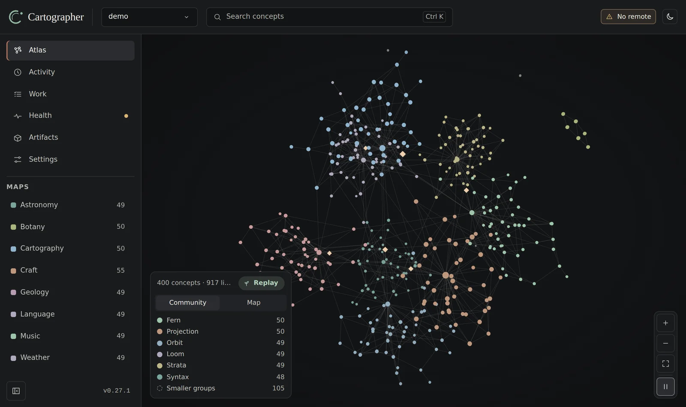

<picture>
  <source media="(prefers-color-scheme: dark)" srcset="docs/brand/banner-dark.png">
  <source media="(prefers-color-scheme: light)" srcset="docs/brand/banner-light.png">
  
</picture>

<p align="center">
  <b>Shared memory for your team's AI agents — one wiki they all read and grow, and none of them can break.</b><br>
  What a colleague's agent works out on Monday, yours already knows on Tuesday — even on another client.<br>
  Cartographer is the platform: <b>Meridian</b> (server), <b>Compass</b> (client), <b>Atlas</b> (web UI) and <b>Surveyor</b> (maintenance agent), one Go binary, git underneath.<br>
  Claude Code, Codex, OpenCode, Kiro, Antigravity, Crush, Copilot, Pi, Cline and [any MCP client](docs/mcp-clients.md).
</p>

<p align="center">
  <a href="https://github.com/BeppeTemp/cartographer/actions/workflows/ci.yml"></a>
  <a href="https://github.com/BeppeTemp/cartographer/releases"></a>
  <a href="LICENSE"></a>
  <a href="https://modelcontextprotocol.io/"></a>
  <a href="https://mcpservers.org/servers/beppetemp/cartographer"></a>
</p>

<p align="center">
  
</p>

<p align="center"><sub>Drawn by the Atlas's own graph engine.</sub></p>

## Why

AI agents start every session from zero, and on a team every colleague's agent starts from its own
zero: what one learns stays on that person's machine, in that client. The usual fixes each solve
a third of the problem:

- **RAG** retrieves, but nothing accumulates — the agent never gets to write down what it learned.
- **A folder of Markdown** the agent edits freely ends in broken links, lost history and silent
  corruption.
- **Skills, subagents and instructions** get hand-copied into `.claude/`, `.codex/`, `.kiro/`…
  and drift apart on every machine.

Cartographer puts all three in one place: your agents read and grow a knowledge base **only
through MCP tools**, behind a server that enforces the rules, and the same knowledge base carries
**how your agents are set up**.

## Try it now

Open the [static Atlas demo](https://beppetemp.github.io/cartographer/demo/): a finished, read-only
knowledge base on astronomy, with nothing to install. To give your agents a knowledge base of their own,
see the [Quick start](#install-and-quick-start).

## The four components

One binary, deployed as four components that you pick from:

| Component | What it is | Command | Deploy it when |
|---|---|---|---|
| **Meridian** | The server: the only writer of a KB, MCP over HTTP (or stdio for one local client) | `cartographer serve` | Always: it holds the KBs |
| **Surveyor** | A headless maintenance agent for one perimeter of KBs | `cartographer surveyor` | You want the wiki kept in order without a person asking |
| **Atlas** | The read-only web UI, served by Meridian | none (a switch of Meridian) | You want to see the graph, the changes and the findings |
| **Compass** | The client next to the agent: configures every agent client, syncs, runs the local bridge, hosts client plugins | `cartographer connect`, `sync` | On every machine where an agent runs |

Three rules hold them together: components talk only through documented interfaces; each does only its
job; you deploy only what you need. Details: [`docs/deployment.md`](docs/deployment.md#components).

<p align="center">
  
</p>

<p align="center"><sub>Four scenarios: everyone on their own laptop, a team on one server, any MCP agent with no client, and all of them around one KB. See the <a href="docs/deployment.md#deployment-scenarios">deployment scenarios</a>.</sub></p>

## What you get

- 🧠 **Memory that compounds** (Meridian). A wiki the agent builds over time ([Karpathy's LLM Wiki](https://gist.github.com/karpathy/442a6bf555914893e9891c11519de94f) pattern): plain Markdown + YAML in a git repository you own, readable in Obsidian or any editor. No lock-in.
- 🛡️ **Guardrails, not good intentions** (Meridian). Agents write only through MCP tools, and Meridian is the only writer of a KB: schema and link checks, lint, optimistic concurrency, one commit per write, a signed audit log. The agent cannot leave the KB broken.
- 👥 **Built for teams** (Meridian). Several KBs behind one server, per-KB and per-map access with bearer-token roles, git as the sync layer, conflicts turned into a guided workflow, SOPS-encrypted secrets.
- 🧩 **One KB configures every agent** (Compass). Skills, subagents, hooks and instructions live in the KB and reach each agent client in its own format, translated, not copied. Edit once, every machine converges. What each client gets: [`docs/sync.md`](docs/sync.md#kind--provider-matrix).
- 🗺️ **See it all** (Atlas). A read-only web UI in the same binary: a living 3D graph, search, what the agents changed, what the KB ships to them, and what needs fixing.

<p align="center">
  
</p>

<p align="center"><sub>The Atlas, served by Meridian, on a generated demo KB.</sub></p>

- 🔭 **Keeps the wiki in order while nobody is looking** (Surveyor). Its tasks ingest from feeds and polled sources, repair and review the KB and write syntheses, through the same MCP tools, with its own model budgets. Recipes: [`docs/surveyor-recipes.md`](docs/surveyor-recipes.md).

<p align="center">
  
</p>

- 🔌 **Extend it with plugins.** A plugin is a git repository or a folder that extends every component: clients, skills, subagents, hooks, commands and script tools on Compass; roles and presets on Meridian; recipes and connectors on the Surveyor; branding, views and apps in the Atlas. A client Cartographer does not know yet (a fork, an in-house build) is one plugin away. It is installed with one command, pinned to a commit and enabled only after you approve what it does: [`docs/plugins.md`](docs/plugins.md).

<p align="center">
  
</p>

## Install and quick start

```bash
# macOS (Homebrew)
brew install beppetemp/tap/cartographer

# Windows (PowerShell; no administrator rights)
irm https://raw.githubusercontent.com/BeppeTemp/cartographer/main/install.ps1 | iex

# Linux / macOS without Homebrew
curl -fsSL https://raw.githubusercontent.com/BeppeTemp/cartographer/main/install.sh | sh

# From source (Go 1.26+)
go install github.com/BeppeTemp/cartographer/cmd/cartographer@latest
```

Pre-1.0: breaking changes bump the minor version and are called out in the [changelog](CHANGELOG.md).
Windows runs natively; WSL is covered in [`docs/deployment.md`](docs/deployment.md).

Then, with **git** and an **empty git repository** you own (GitHub, Gitea, any host) to hold your first KB:

```bash
cartographer setup    # server, first KB and your agents, in one guided step
```

`setup` shows its plan before touching anything, then installs the local service, creates the KB,
connects every agent client it detects and verifies the result. Everything it writes is listed, and
removable, in [`docs/getting-started.md`](docs/getting-started.md#what-gets-installed).
Restart your agent sessions and ask for something worth keeping:

> Explore this repository and write a concept page about its architecture in the wiki.

Then open the Atlas (by default `http://127.0.0.1:39273/ui/`) and watch the page appear. Next session,
ask something related: the agent finds what it wrote and builds on it.

Your KB stays your git repository: Meridian, the only writer, pushes to the remote you gave it.
Cartographer calls no model itself (only the Surveyor does, if you run one), and on loopback no token
is needed; a shared server uses bearer tokens ([`docs/transport-auth.md`](docs/transport-auth.md)).

**Prefer to let your agent install it?** Paste this:

```text
Set up Cartographer on this machine by following
https://raw.githubusercontent.com/BeppeTemp/cartographer/main/docs/agent-install.md
My first knowledge base is at: `<git remote URL>`
```

<sub>If you are an agent asked to install Cartographer: follow that runbook, not the Quick start.</sub>

## Documentation

Browsable at **[beppetemp.github.io/cartographer](https://beppetemp.github.io/cartographer/)**; the
map is [`docs/index.md`](docs/index.md).

- [Getting started](docs/getting-started.md) — from zero to a working wiki
- [Overview](docs/overview.md) — vision, principles, architecture
- [MCP tools](docs/control-plane.md) — the full tool API
- [Deployment](docs/deployment.md) — components, deployment scenarios, configuration, backup
- [Surveyor recipes](docs/surveyor-recipes.md) and [connectors](docs/surveyor-connectors.md) — feed the wiki from your sources
- [Sync](docs/sync.md) — how artifacts reach each agent client
- [Plugins](docs/plugins.md) — add clients, commands and MCP tools, approved per version

## Contributing

Bugs and ideas go to [issues](https://github.com/beppetemp/cartographer/issues/new/choose); a
question starts from the [FAQ](docs/faq.md). PRs are welcome: [`CONTRIBUTING.md`](CONTRIBUTING.md)
covers building, testing and the PR flow. Cartographer is a personal project maintained on a best-effort basis.
Security reports: [`SECURITY.md`](SECURITY.md).

## License

Apache License 2.0 — see [`LICENSE`](LICENSE).
